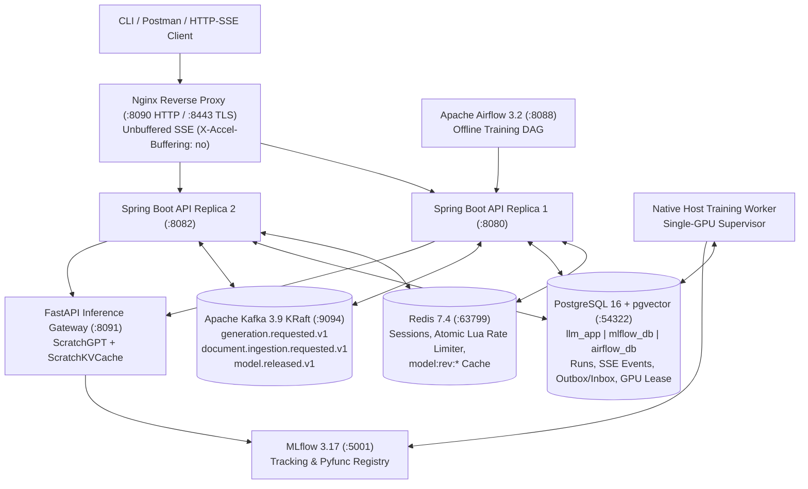

# ScratchLLM Platform (`v1.0.0`) — End-to-End LLM System from Scratch

An end-to-end **Large Language Model & Distributed Application Platform** built from scratch across a 120-day engineering roadmap ([`roadmap.md`](roadmap.md), [`design.md`](design.md)). It combines a custom PyTorch decoder-only Transformer ([`ScratchGPT`](ml/src/scratchlm/model/gpt.py)) and byte-level BPE tokenizer ([`ByteLevelBPETokenizer`](ml/src/scratchlm/tokenizer/bpe_tokenizer.py)) with a production-disciplined **Java 21 / Spring Boot 3.4** modular monolith, **PostgreSQL 16 + `pgvector`**, **Redis 7.4**, **Apache Kafka 3.9 (KRaft)**, **MLflow 3.17**, and **Apache Airflow 3.2**.

---

## 1. Problem Statement & Honest Capability Scope

Modern AI engineering requires both **model-level understanding** (tokenization, causal attention, KV caching, pretraining, SFT, evaluation) and **distributed systems rigor** (idempotent APIs, durable Server-Sent Events replay, transactional outbox/inbox, atomic rate limiting, workspace-isolated RAG, and single-GPU mutual exclusion).

### What This System Is (and Is Not)
- **What Is Built from Scratch**:
  - Byte-level BPE tokenizer ([`ByteLevelBPETokenizer`](ml/src/scratchlm/tokenizer/bpe_tokenizer.py)) trained strictly on the training split.
  - Pre-norm decoder-only GPT Transformer ([`ScratchGPT`](ml/src/scratchlm/model/gpt.py)) with tied input/output embeddings, custom [`ScratchLayerNorm`](ml/src/scratchlm/model/normalization.py), scaled residual projections ($1/\sqrt{2L}$), and incremental [`ScratchKVCache`](ml/src/scratchlm/inference/kv_cache.py).
  - Full Spring Boot orchestration layer (`Flyway V1–V7`), Redis session/Lua rate-limit/cache-aside metadata, Kafka transactional outbox/inbox + leased work items, `pgvector` hybrid retrieval, MLflow registry promotion/rollback with monotonic `release_generation`, and Airflow-to-host-GPU training supervision.
- **Honest Model Capability**:
  - `ScratchGPT` (`~0.85M–1.25M` parameters, `max_seq_len = 128`) is trained from random initialization on a narrow storytelling and instruction corpus (`TinyStories` subset + authored SFT fixtures) within a single workstation (`8 CPU threads`, `16 GB RAM`, `1x NVIDIA Quadro M2000M 4 GB VRAM` or CPU fallback).
  - It demonstrates genuine learning (held-out test perplexity drops significantly vs. untrained/unigram/bigram baselines and follows SFT chat formatting), **not** frontier world knowledge or general reasoning.
  - RAG embedding vectors use a pinned, declared CPU feature-hash/sentence embedding pipeline ([`DocumentIngestionAndRetrievalService.java`](backend/src/main/java/com/scratchllm/platform/documents/DocumentIngestionAndRetrievalService.java)); retrieval recall is measured independently of the tiny generator's prose quality.

---

## 2. System Architecture



---

## 3. Quick Start (CPU Demo & Local Workstation Profiles)

### 3.1 Fast CPU-Only Demo & Full Verification Suite
```powershell
# 1. Start core platform & tracking containers (PostgreSQL, Redis, Kafka, MLflow)
docker compose --env-file infra\.env.example -f infra\compose.yml --profile platform --profile tracking up -d

# 2. Run the self-contained CPU-only ScratchGPT KV-cache & benchmark verification
powershell -ExecutionPolicy Bypass -File scripts\run_cpu_demo.ps1

# 3. Run the complete 5-stage verification gate (Secret scan, Compose, Hardware Probe, 68 Pytest tests, 41 JUnit tests)
powershell -ExecutionPolicy Bypass -File scripts\check_all.ps1
```

### 3.2 Sequential Workstation Profiles (`16 GB RAM` Budget)
See [`docs/local-setup.md`](docs/local-setup.md) and [`docs/deployment.md`](docs/deployment.md) for staged profiles (`db`, `platform`, `tracking`, `pipelines`) and two-replica launch scripts ([`scripts/start_native_services.ps1`](scripts/start_native_services.ps1)).

---

## 4. Key Engineering Documentation & Evidence Links

| Topic | Artifact |
| :--- | :--- |
| Architecture & ADRs (`Day112`) | [`docs/architecture/overview-and-diagrams.md`](docs/architecture/overview-and-diagrams.md), [`docs/architecture/adrs.md`](docs/architecture/adrs.md) |
| Custom Transformer Walkthrough (`Day113`) | [`docs/transformer-walkthrough.md`](docs/transformer-walkthrough.md) |
| Model, Data & Tokenizer Cards (`Day114`) | [`docs/cards/model-card.md`](docs/cards/model-card.md), [`docs/cards/data-card.md`](docs/cards/data-card.md), [`docs/cards/tokenizer-card.md`](docs/cards/tokenizer-card.md) |
| Sealed Final Test Evaluation (`Day114`) | [`ml/artifacts/evals/day114_sealed_final_test_evaluation.json`](ml/artifacts/evals/day114_sealed_final_test_evaluation.json) |
| Consolidated Engineering Report (`Day115`) | [`docs/engineering-report.md`](docs/engineering-report.md) |
| Reproducible CLI & Postman Demo (`Day116`) | [`docs/demo-script.md`](docs/demo-script.md), [`docs/postman/scratchllm-release-collection.json`](docs/postman/scratchllm-release-collection.json) |
| Operations, Restore Drill & Release Checklist | [`docs/mlops-runbook.md`](docs/mlops-runbook.md), [`docs/restore-drill.md`](docs/restore-drill.md), [`docs/release-checklist.md`](docs/release-checklist.md) |
| Gate Evidence Reports (`G9`–`G12`) | [`g9-gate-evidence.md`](docs/reports/g9-gate-evidence.md), [`g10-gate-evidence.md`](docs/reports/g10-gate-evidence.md), [`g11-gate-evidence.md`](docs/reports/g11-gate-evidence.md), [`g12-gate-evidence.md`](docs/reports/g12-gate-evidence.md) |

---

## 5. Completed Scope vs. Optional Post-120-Day Extensions

- **Completed in `v1.0.0` (Phases 1–12)**:
  - Custom `ByteLevelBPETokenizer` + `ScratchGPT` pretraining, narrow SFT, and `ScratchKVCache` incremental decoding.
  - Spring Boot API with owner-isolated workspaces/conversations, Redis sessions + Lua rate limits + metadata cache, durable PostgreSQL SSE replay (`Last-Event-ID`), Kafka transactional outbox/inbox + DLQ, workspace-scoped `pgvector` RAG with verified citations, MLflow registry promotion/rollback with monotonic `release_generation`, and Airflow-to-native-worker GPU-exclusive training.
- **Explicitly Deferred Post-120-Day Extensions**:
  - RoPE / RMSNorm / SwiGLU ablations, multi-GPU DistributedDataParallel (DDP), DPO preference tuning, external pretrained LLM comparison providers, and multi-host Kubernetes HA.
