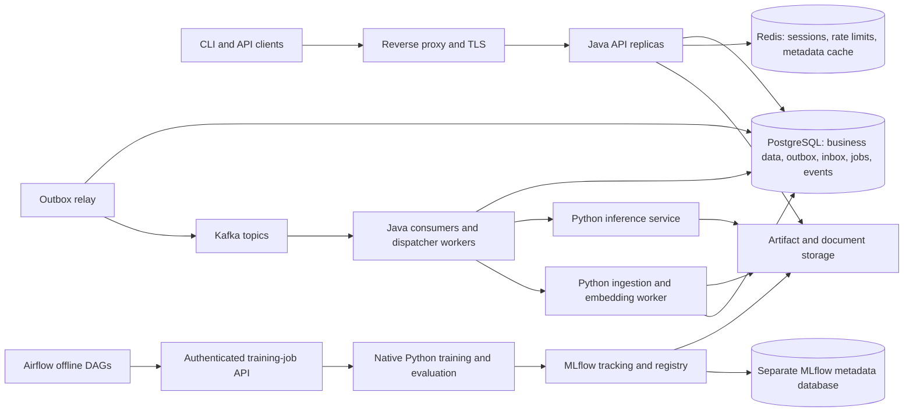
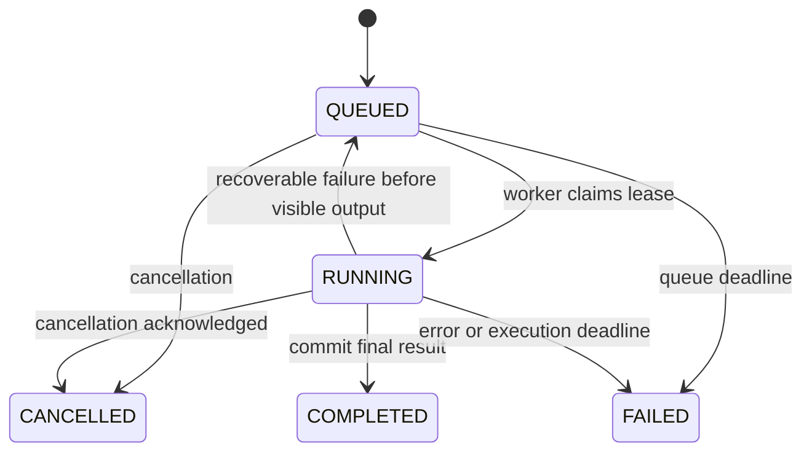
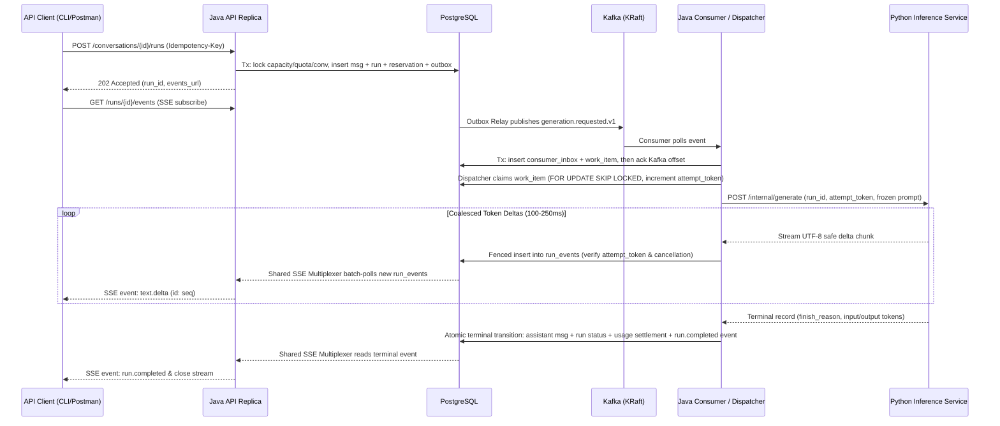
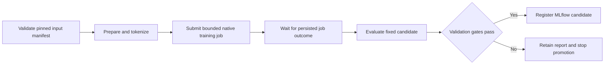

# Design: a scalable conversational AI platform with a transformer built from scratch

Status: proposed architecture, not an implemented system. Revised on 9 October 2026: API-only product; Redis, Kafka, MLflow, and Airflow are required release components.

Companion document: [120-day implementation roadmap](roadmap.md).

## 1. Project outcome and scope

Build a portfolio system that demonstrates the complete path from training data to a running conversational API: data preparation, a decoder-only transformer written in PyTorch, training, experiment tracking, pipeline orchestration, evaluation, model packaging, Python inference, a Java application backend, deployment, and measured scaling.

The product is **backend and ML only**. There is no custom frontend, template engine, or browser-interface implementation in scope. Demonstrate the APIs using `curl.exe`, an exported Postman collection, and a small Python `httpx` command-line client for SSE and replay. The existing operator consoles supplied by MLflow and Airflow are infrastructure tools, not a frontend to build.

The product takes inspiration from ChatGPT and Claude: conversations, streaming responses, saved history, document retrieval, model selection, feedback, and usage limits. Its required model is a small language model trained from random weights. A successful project demonstrates sound implementation and honest measurements; it does not claim the knowledge, reasoning quality, safety, or operating scale of a frontier assistant.

The central portfolio story is: **I built the model internals, trained and evaluated a small model, integrated it into a reliable service, and measured the system's bottlenecks.**

### Required release

- Registration/login, workspace ownership, conversation history, and a documented API with scripted demonstrations.
- Streaming generation with explicit cancellation, reconnect/replay, deadlines, bounded queues, and persisted outcomes.
- A working scratch transformer, tokenizer, training loop, checkpoint/resume, narrow supervised fine-tuning experiment, and reproducible evaluation.
- MLflow experiment tracking and Model Registry, immutable model provenance in API responses, and exercised promotion/rollback.
- Redis-backed sessions, distributed rate limiting, and bounded metadata caching.
- Kafka-backed asynchronous handoff with transactional outbox, consumer deduplication, bounded retries, and dead-letter handling.
- An Airflow DAG that prepares data, submits bounded training, evaluates results, and registers eligible candidates in MLflow.
- Document ingestion and retrieval with source references, isolation between workspaces, and independent retrieval evaluation.
- Tests, CI, metrics/traces, measured load results, a deployment profile, backup/restore drill, and documented limitations.
- A public or locally reproducible API demo with terminal recordings, example requests, reports, and clear setup instructions.

### Extensions after the required release

Larger models, external model providers, advanced positional encodings, DPO, distributed training, continuous batching, quantization, Kubernetes, and multi-region deployment are separate extensions. Redis, Kafka, MLflow, and Airflow are part of the required release; they must have working integrations and acceptance evidence before Day120.

## 2. Time, hardware, and feasibility

The agreed schedule is **120 workdays at 3–4 hours/day**, approximately 360–480 hours. Days are work sessions, not fixed calendar dates. Frontend work is replaced by infrastructure and MLOps work, and the tiny-model path bounds training cost. This is an ambitious scope that assumes basic Java, Python, SQL, Git, HTTP, and calculus familiarity. If prerequisite gaps or integration failures exceed the buffers, extend the calendar rather than silently dropping a required service or correctness gate.

### Observed development machine

These values were read locally; disk space is only a point-in-time snapshot.

| Item | Observation | Design consequence |
|---|---|---|
| GPU | NVIDIA Quadro M2000M, 4,096 MiB VRAM, compute capability 5.0 | Small FP32 models; one generation at a time initially |
| GPU driver | 573.71 | Preserve the working environment while testing alternatives separately |
| CPU | Intel i7-6820HQ, 4 physical cores / 8 logical processors | Limit data-loader workers and background services |
| RAM | Approximately 47.9 GiB | Enough for a modest local platform; keep explicit per-process limits |
| Free disk | C: approximately 12.4 GiB; E: approximately 17.5 GiB | Storage planning is a prerequisite to the required container profiles, datasets, and checkpoints |
| Java / Python | Java 21 installation; Python 3.12 | Suitable starting language baselines |
| Installed PyTorch | `2.6.0+cu118`; CUDA build 11.8; `sm_50` present | Existing compatibility baseline, not an instruction to install the newest wheel |
| Actual smoke check | CUDA available; a 32×32 FP32 matrix multiplication and backward pass completed | Confirms a small operation works, not transformer throughput or training stability |

NVIDIA lists this mobile GPU under compute capability 5.0. Maxwell is not officially supported for CUDA in WSL 2, so local GPU training/serving should begin in **native Windows Python**. Linux/WSL CPU services can be used independently. See [NVIDIA legacy GPU table](https://developer.nvidia.com/cuda/gpus/legacy) and [CUDA on WSL limitations](https://docs.nvidia.com/cuda/wsl-user-guide/index.html).

PyTorch GPU support depends on the wheel's CUDA build and compiled architectures; a successful `nvidia-smi` call alone does not prove compatibility. Newer build lines have removed support for older architectures. Preserve a reproducible local lock, inspect dependency security/support before a public release, and evaluate a supported CPU runtime for a public demo if a maintained GPU combination is unavailable. Never expose a training environment directly to the internet. Sources: [PyTorch architecture support announcement](https://dev-discuss.pytorch.org/t/cuda-toolkit-version-and-architecture-support-update-maxwell-and-pascal-architecture-support-removed-in-cuda-12-8-and-12-9-builds/3128), [official version installation reference](https://pytorch.org/get-started/previous-versions/).

### Resource policy

1. Required work must be possible with the tiny model on this machine. No paid API or rented GPU is assumed.
2. Start with CPU-correctness tests and FP32 manual attention. Do not require BF16, FlashAttention, or GPU quantization kernels on this card.
3. Profile 200 training steps after warm-up before selecting the next model tier or token budget.
4. Do not train and serve on the GPU simultaneously. Keep the fake inference provider available for backend work during training.
5. Start with a 2 GiB cap on processed local corpora and 2 GiB on retained model artifacts; raise these only after a disk inventory. Keep the best checkpoint and the latest resumable checkpoint, writing atomically with room for temporary copies.
6. Run expensive training/evaluation and load tests separately. Record wall-clock training time in addition to active development time.
7. If GPU compatibility or runtime becomes a blocker, complete the release using the tiny CPU profile. Larger models are additional evidence, not a completion requirement.
8. Run infrastructure in bounded Compose profiles: `platform` for PostgreSQL/Redis/Kafka, `tracking` for MLflow, and `pipelines` for Airflow. Start only the needed profiles during development; exercise the integrated profile before release. Measure RAM/CPU/disk rather than assuming all services fit comfortably on four CPU cores.
9. Inventory image sizes, layers, logs, Kafka retention, database volumes, and MLflow artifact copies before downloads. Allocate sufficient free space or move the project data root; do not delete unrelated user files. The previously observed free space is not a guaranteed full-stack storage budget.

### Compose profile and host resource allocation budget

To protect the 4-core / 8-thread CPU (`i7-6820HQ`), 4 GiB VRAM (`Quadro M2000M`), and tight disk capacity (`~12.4 GiB` on `C:`, `~17.5 GiB` on `E:`), stage services using explicit Docker Compose profiles and process caps:

| Profile / Process Group | Active Services | CPU / Memory Cap | Storage & Port Binding Policy | When Active |
|---|---|---|---|---|
| `platform` (Compose) | PostgreSQL 16 (`pgvector`), Redis 7, Kafka KRaft (1 broker) | PG: `1.0 CPU / 2 GiB`; Redis: `0.5 CPU / 512 MiB` (`noeviction`); Kafka: `1.0 CPU / 1.5 GiB` (`-Xmx768M`) | Bind `127.0.0.1` only; Kafka log retention `24h` / `512 MiB` per partition; relocate volume data root to `E:\llm-data` if `C:` < 15 GiB | Online API development, integration tests, Phases 1–2, 6–8, 10–12 |
| `tracking` (Compose) | MLflow tracking/registry server (`--serve-artifacts`) | `0.5 CPU / 1 GiB` | Uses dedicated `mlflow_db` schema/database on PostgreSQL; artifact root capped at `2 GiB` | Model training, evaluation, and promotion (Phases 4–6, 9–12) |
| `pipelines` (Compose) | Airflow (`LocalExecutor`, scheduler + webserver/triggerer) | `1.5 CPU / 2.5 GiB` (`AIRFLOW__CORE__PARALLELISM=2`, max 1 active DAG run) | Uses dedicated `airflow_db` database; task logs capped at `500 MiB` with rotation | Offline MLOps pipeline execution and recovery tests (Phases 9–12) |
| Native Host Online | Java API (1–2 replicas), Java Dispatcher, Python FastAPI Model Server | Java: `-Xmx768m` each; Python Server: 1 Uvicorn worker, `1 GPU slot` (or CPU fallback) | Ephemeral logs; reads immutable model packages from verified local cache | Interactive chat, retrieval, and scaling benchmarks |
| Native Host Offline | Native Windows Training Worker API + child training subprocess | 1 active GPU process (`MAX_WORKERS=1`, `num_workers=0` or `2` on DataLoader) | Atomic checkpoint writes (`best.pt`, `last.pt`) capped at `2 GiB` total | Pretraining, SFT, and Airflow-triggered training jobs |

## 3. Architecture and technology choices

Use a **Java modular monolith**, **Python inference/training workers**, **PostgreSQL**, **Redis**, **Kafka**, **MLflow**, and **Airflow**. Training remains a standalone Python command that Airflow can orchestrate through a bounded job interface. Java API and worker roles share domain modules but run independently for the scale demonstration.



API clients access the Java application. Python endpoints, infrastructure consoles, database credentials, and artifact paths remain internal. Airflow coordinates finite offline jobs; interactive chat generation follows Java -> Kafka handoff -> dispatcher -> Python -> durable SSE events. Redis does not own message history or token accounting. PostgreSQL remains authoritative for those records.

### Cross-OS boundary (Windows native host vs. Linux containers)

Because the Maxwell GPU (`sm_50`) runs in native Windows Python while Airflow, MLflow, Kafka, Redis, and PostgreSQL run in Linux containers, enforce three cross-boundary rules from Day 1:

1. **Logical Artifact URIs (`mlflow-artifacts:/`)**: Run MLflow with `--serve-artifacts` so both Linux containers (Airflow tasks) and Windows native processes (training and serving workers) upload and download model packages through MLflow's HTTP artifact proxy. Never persist raw Windows paths (`E:\...`) or container paths (`/opt/mlflow/...`) in database records or XCom payloads.
2. **Host-Gateway Network Binding**: Linux containers reach the native Windows training-job API via `host.docker.internal` (mapped with `extra_hosts: ["host.docker.internal:host-gateway"]`), authenticated with a dedicated `X-Internal-Service-Token` header and bound strictly to local interface addresses.
3. **UTC Clock & Monotonic Lease Discipline**: All timestamps across Windows and WSL2/Docker use UTC (`TIMESTAMPTZ`), and lease renewals rely on database server time (`clock_timestamp()` / `now()`) rather than comparing uncalibrated host vs. container wall clocks.

| Area | Choice | Why it is here |
|---|---|---|
| Java runtime/build | Java 21, Maven Wrapper | Familiar baseline already installed; reproducible builds |
| Java application | A supported Spring Boot 4.x stable patch (or latest stable 3.4.x if a required Spring Kafka/Session integration lags at Day 1 setup), pinned in `pom.xml` | Dependency management and application lifecycle |
| HTTP | Spring MVC, `SseEmitter`, internal HTTP client | Fits blocking JPA and provides SSE to API clients |
| Persistence | Spring Data JPA, Hibernate, PostgreSQL, Flyway | Transactions, explicit schemas, migrations, relational ownership |
| Authentication | Spring Security, password hashing, CSRF-protected server sessions | API clients use a cookie jar and explicit CSRF headers |
| Shared sessions/cache/rate limits | Redis, Spring Session Data Redis, Spring Data Redis | Shared login state, atomic request throttling, immutable metadata cache |
| API demonstration | `curl.exe`, Postman collection, Python `httpx` SSE client | Reproducible requests and streamed results without frontend development |
| ML | Python 3.12, PyTorch, NumPy, pytest | Own model and training implementation with established tensor/autograd primitives |
| Python HTTP | FastAPI, Pydantic, Uvicorn | Typed private inference and preprocessing contracts |
| Retrieval | PostgreSQL full-text search first; pgvector and CPU embeddings next | Compare lexical and vector retrieval without another database |
| Messaging | Apache Kafka in KRaft mode, Spring for Apache Kafka | Durable asynchronous handoff, partitions, consumer groups, retry/DLQ handling |
| Work scheduling | PostgreSQL outbox/inbox, leased execution records, Java dispatchers | Atomic business writes and recovery of long jobs handed off by Kafka |
| Experiment tracking/registry | MLflow with its own PostgreSQL database and artifact root | Run comparison, model lineage, candidate versions, and release metadata |
| Offline orchestration | Apache Airflow with LocalExecutor and its own PostgreSQL database | Dependency-managed dataset/training/evaluation DAGs with retries |
| Storage | Local filesystem adapter; object storage adapter later | Fits local constraints and preserves an upgrade path |
| Testing | JUnit, Spring integration tests, Testcontainers/service containers, pytest, HTTP/SSE smoke tests | Verify real PostgreSQL/Redis/Kafka and ML pipeline boundaries |
| Observability | Structured logs, Micrometer, OpenTelemetry; optional Prometheus/Grafana profile | Correlate user requests, backend work, and model execution |
| Delivery | GitHub Actions; required Docker Compose CPU infrastructure profiles; native Java/Python processes | Repeatable infrastructure, checks, and hardware-compatible execution |
| Load tests | k6 or a small documented HTTP/SSE load harness | Repeatable capacity measurements |

Pin exact Java/Python dependencies and images after compatibility checks; use stable releases rather than snapshots or floating tags. Let Spring Boot manage compatible Spring/Hibernate versions. Java 21 is within the current documented Boot compatibility range. [Spring Boot requirements](https://docs.spring.io/spring-boot/system-requirements.html).

Spring Session supports Redis-backed HTTP sessions across replicas. Use its supported serializer/configuration and explicit TTLs; keep application authorization in PostgreSQL. [Spring Session Redis configuration](https://docs.spring.io/spring-session/reference/configuration/redis.html).

Spring MVC supports asynchronous SSE responses, but servlet response writes still require bounded execution resources. Do not place blocking JPA operations on a reactive event loop or hold a transaction open for the duration of generation. Configure async executor capacity and timeouts explicitly. [Spring MVC asynchronous request documentation](https://docs.spring.io/spring-framework/reference/web/webmvc/mvc-ann-async.html).

## 4. Repository and module boundaries

This is the proposed future layout. Only the two planning documents are delivered initially.

```text
LLM/
  design.md
  roadmap.md
  README.md
  backend/
    pom.xml
    src/main/java/.../
      identity/           # users, workspaces, memberships
      conversation/       # conversations, messages, feedback
      generation/         # runs, provider interface, events, cancellation
      usage/              # admission, reservations, settlement
      knowledge/          # documents, chunks, retrieval, citations
      modelcatalog/       # immutable revisions and active aliases
      jobs/               # Kafka consumers, outbox/inbox, leases, recovery
      infrastructure/     # Redis rate/cache/session integration
      platform/           # HTTP/security/config/observability
    src/main/resources/db/migration/
    src/test/
  ml/
    pyproject.toml
    configs/              # tiny, local, experimental
    src/scratchlm/
      data/               # manifests, splits, packing
      tokenizer/          # byte tokenizer and own BPE
      model/              # attention, norm, block, decoder
      training/           # loop, optimizer setup, checkpoints
      evaluation/         # loss, generation, instruction metrics
      inference/          # sampling, KV cache, context packing
      serving/            # FastAPI contracts and model process
      retrieval/          # parsing and embedding adapter
    tests/
  contracts/              # OpenAPI, JSON Schema, example streams
  api-tests/              # HTTP/SSE tests and exported request collection
  pipelines/
    dags/                 # Airflow orchestration only, no training at parse time
    tests/                # DAG import, task contracts, retry/recovery checks
  mlops/                  # MLflow setup, promotion adapter, lineage manifests
  infra/                  # local profiles, Compose, proxy configuration
  scripts/                # setup, smoke, backup, restore, benchmark
  docs/
    adr/                  # architecture decisions and tradeoffs
    model-card.md
    data-card.md
    runbooks/
    reports/              # measured quality, load, failure, recovery results
  .github/workflows/
```

Keep tests near their owning component. Use package/module boundaries and architecture checks before introducing more deployable services. Store large datasets, weights, caches, credentials, and user documents outside Git. Publish permitted small artifacts through a release or external artifact store with checksums.

## 5. API behavior and demonstrations

The public interface is an HTTP API for login, create/list/rename/delete conversation, submit prompt, stream answer, cancel, retry, model metadata, and feedback. Return explicit queued/running/failed/cancelled states and machine-readable errors. Treat generated content as data; the service does not render it into a page or execute generated commands.

One active generation per conversation keeps message ordering understandable. Retrying creates a new run linked to the original attempt; failed partial messages remain labelled and do not silently enter future context as successful assistant turns. Editing earlier messages and conversation branching are extensions.

Model metadata must distinguish `scratch-tiny`, `scratch-local`, a deterministic development fake, and any later external model. Include the immutable registry version, tokenizer hash, and a capability note describing the local model's limited language and instruction-following ability.

Workspace search returns source title, chunk identifier, location, and authorized excerpts as JSON. Generation events can include those source references; generated claims still need independent evaluation. The CLI demo prints retrieved excerpts separately from generated text. Never describe a retrieved document as proof of an unsupported generated statement.

Deliver a Postman collection and Python CLI that can authenticate, submit a run, print incremental SSE text, reconnect with a cursor, cancel, and retrieve persisted results. The CLI is a thin test/demo client with no duplicate authorization or model logic.

Conversations, messages, runs, and feedback are creator-private even when two users belong to the same workspace: access requires both current membership and the owning user. Documents are workspace-shared for reading/search; deletion is restricted to their uploader or a workspace owner. Test cross-workspace access and same-workspace access separately. Workspace ownership does not implicitly grant access to another user's private chat.

## 6. Data model and JPA design

Use UUID identifiers, UTC timestamps, explicit foreign keys, migration-managed indexes, and `@Version` for mutable entities where optimistic locking is useful. Every resource query includes its authorized workspace scope. Domain entities do not double as public response DTOs.

| Table | Important fields and constraints |
|---|---|
| `users` | `id`, normalized unique email, password hash, status |
| `workspaces` / `memberships` | Workspace ID; unique `(workspace_id, user_id)`; role `OWNER` or `MEMBER` |
| `conversations` | Workspace ID, owner, title, version, deletion timestamp |
| `messages` | Conversation ID, role, content, status, order; unique assistant result for a run |
| `generation_runs` | Workspace/conversation/user IDs, status, immutable model revision, prompt snapshot hash, sampling options, deadlines, attempt token, cancellation flag, error code |
| `idempotency_records` | Unique `(workspace_id, user_id, operation, key)`; request hash; response/run ID; expiry |
| `work_items` | Kind, run/document ID, state, lease owner, lease expiry, fencing counter, attempt count, next eligible time |
| `outbox_events` | Stable event ID, schema version, aggregate key, bounded payload/reference, relay lease, publish attempts, published timestamp |
| `consumer_inbox` | Unique `(consumer_name, event_id)`, payload hash, processed timestamp; deduplication across redelivery |
| `run_events` | Unique `(run_id, sequence)`; type, payload, creation time; index for replay |
| `usage_buckets` / `usage_reservations` | Daily workspace/user allowance; one reservation per run; reserved and settled token values |
| `documents` | Workspace ID, storage key, checksum, filename, MIME type, ingestion status, deletion state |
| `document_chunks` | Document/workspace IDs, order, text, source location, embedding revision, vector |
| `retrieval_snapshots` | Run ID, chunk IDs/revisions, ranks, scores, bounded excerpts used in context |
| `model_revisions` | Application projection of immutable MLflow model name/version/run ID, artifact checksum, tokenizer hash, context limit, evaluation/readiness state |
| `model_promotions` | Unique promotion ID, monotonically increasing per-model release generation, requested registry version, previous version, approval, readiness result, reconciliation status |
| `training_jobs` | Stable external job key, allowlisted config/hash, Airflow lineage, status, native process identity, checkpoint reference, heartbeat/deadline |
| `feedback` / `audit_events` | Actor/resource metadata, rating/reason; no raw prompt required in audit records |

Use composite keys/constraints where useful to prevent cross-workspace references, plus service-level authorization on every lookup. A random UUID is not an authorization mechanism. Start with owner-created workspaces and seeded test memberships; invitation/email workflows are optional.

Use separate PostgreSQL databases and credentials for application data, MLflow metadata, and Airflow metadata, even if one local PostgreSQL server hosts them. Each service owns its migrations. Do not map MLflow/Airflow internals into application JPA entities.

JPA implementation requirements:

- Disable Open Session in View. Map to DTOs inside short read transactions.
- Use projections, explicit fetch joins, or entity graphs to prevent N+1 queries. Do not mark every relation eager.
- Use keyset pagination for long conversation/message histories; bound page sizes.
- Index `(workspace_id, updated_at, id)`, `(conversation_id, message_order)`, and eligible work queries based on actual plans.
- Keep remote HTTP calls, token generation, filesystem writes, and SSE delivery outside database transactions.
- Use narrow native SQL where queue claiming, vector search, or atomic counters need database-specific behavior; JPA need not abstract every operation.
- Test migrations against PostgreSQL. Do not infer PostgreSQL locking/vector behavior from an H2 test.
- Give Python ingestion a restricted role or scoped internal write API for ingestion tables; it must not mutate identity, usage, or conversations.

### Database concurrency invariants, partial unique indexes, and lock hierarchy

Enforce concurrency invariants in PostgreSQL schema definitions rather than relying on application-memory checks:

1. **One Active Run Per Conversation**:
   ```sql
   CREATE UNIQUE INDEX uq_active_run_per_conversation
       ON generation_runs (conversation_id)
       WHERE status IN ('QUEUED', 'RUNNING');
   ```
2. **One Assistant Message Per Run**:
   ```sql
   CREATE UNIQUE INDEX uq_assistant_msg_per_run
       ON messages (run_id)
       WHERE role = 'ASSISTANT';
   ```
3. **Deadlock-Free Lock Acquisition Order**: Whenever a transaction locks multiple mutable rows during admission or settlement, acquire locks in this strict canonical order:
   `system_capacity (singleton admission counter)` $\rightarrow$ `usage_buckets (workspace_id, user_id, utc_date)` $\rightarrow$ `conversations (id)` $\rightarrow$ `generation_runs (id)`.
4. **Fenced Worker Writes**: Every chunk append, heartbeat renewal, and terminal transition issued by a dispatcher worker must include the fencing predicate `WHERE id = :runId AND attempt_token = :attemptToken AND status = 'RUNNING'` (or `status IN ('QUEUED', 'RUNNING')` for cancellation/expiry) and verify `rows_affected == 1`.

## 7. Public API and streaming contract

Use `/api/v1`, JSON DTOs, validation errors with stable codes, request IDs, and a versioned OpenAPI contract. Examples below are planned contracts.

| Method and path | Behavior |
|---|---|
| `GET /auth/csrf` | Bootstrap session/CSRF token for a cookie-jar API client |
| `POST /auth/register`, `POST /auth/login`, `POST /auth/logout` | CSRF-protected authentication and Redis-backed session lifecycle |
| `GET /api/v1/me` | Current user and allowed workspaces |
| `POST /api/v1/workspaces/{w}/conversations` | Create conversation |
| `GET /api/v1/workspaces/{w}/conversations?cursor=...` | Paginated history |
| `GET /api/v1/conversations/{id}/messages?cursor=...` | Authorized messages |
| `PATCH /api/v1/conversations/{id}` | Rename with version conflict handling |
| `DELETE /api/v1/conversations/{id}` | Tombstone, cancel active work, schedule deletion |
| `POST /api/v1/conversations/{id}/runs` | Idempotent submission; return `202` with run ID and event URL |
| `GET /api/v1/runs/{id}` | Durable status, output snapshot, and usage |
| `GET /api/v1/runs/{id}/events` | SSE stream with event IDs and replay |
| `POST /api/v1/runs/{id}/cancel` | Idempotent cancellation request |
| `GET /api/v1/models` | Allowed models and capability/provenance metadata |
| `POST /api/v1/workspaces/{w}/documents` | Bounded upload; `202` with ingestion status URL |
| `GET /api/v1/documents/{id}`, `DELETE /api/v1/documents/{id}` | Status / authorized deletion |
| `POST /api/v1/workspaces/{w}/search` | Authorized lexical/vector retrieval |
| `POST /api/v1/messages/{id}/feedback` | Explicit user feedback |
| `GET /api/v1/usage` | Caller-scoped quota and usage summary |

Run submission includes `Idempotency-Key`, prompt, selected model alias, bounded sampling options, and optional document IDs. After authentication/authorization and basic request validation, check for an existing idempotency record before new-run quota, active-run, or capacity admission. The same key and canonical client request returns the original run without new reservations; a changed body returns `409`. Hash the client-supplied alias/settings, not its currently resolved revision. Resolve an alias only for a new request and freeze that revision when recording the run. A distinct new request against a conversation with an active run produces a conflict. Concurrent first submissions recheck under the unique constraint/transaction rather than relying on a preflight lookup alone.

HTTP clients bootstrap a cookie jar and CSRF token through `/auth/csrf`, then send the cookie plus CSRF header on writes, including login/logout. Refresh the CSRF token after login rotates the session. Configure HttpOnly cookies, Secure in HTTPS deployments, suitable SameSite settings, TTLs, and explicit session invalidation. `curl.exe`, Postman, and `httpx` support the required headers/cookies; no token belongs in an event-stream URL. Reauthorize subscriptions, enforce a maximum stream lifetime, and close/revalidate streams when access is revoked. Keep CORS disabled unless an independently authorized client requirement arises.

An example stream:

```text
id: 1
event: run.started
data: {"run_id":"...","model_revision":"scratch-local-r1","schema_version":1}

id: 2
event: text.delta
data: {"text":"Once upon a time"}

id: 3
event: run.completed
data: {"finish_reason":"length","input_tokens":92,"output_tokens":64}
```

Additional events: `run.queued`, `sources`, `run.cancelled`, and `run.failed`. A transport heartbeat is an SSE comment, not an output token. Persist bounded text chunks rather than one row per token; initially coalesce up to 100–250 ms or a small byte threshold. Tune that against latency and write volume.

Replay uses `Last-Event-ID` or a validated `after` cursor. The CLI ignores previously applied sequence IDs. Closing a stream detaches the subscriber; it does not cancel a job. Cancellation uses the explicit endpoint. If a cursor has expired, send a typed `resync.required` control event; the client closes the stream and fetches the durable output snapshot. Stop reconnecting after a terminal event. HTTP clients distinguish authentication/transport errors from model failures using status codes and the agreed event envelope.

## 8. Generation lifecycle, durability, and backpressure





### Durable execution sequence

1. Authenticate and authorize, validate byte/character limits, and resolve idempotent replay first. For a new logical request, perform rate admission and use a short transaction to lock the shared capacity row, conversation, and quota bucket in a consistent order.
2. Atomically create the user message, run, idempotency record, quota reservation, and `generation.requested.v1` outbox event. Freeze the prompt/history, selected document revisions, and model/settings. Enforce bounded outstanding runs with shared database counters/locks. Return `202` after commit. Do not create a runnable producer-side work item that bypasses Kafka.
3. The outbox relay publishes the stable event ID to Kafka and records broker acknowledgement. A Java consumer atomically inserts its inbox deduplication row and the execution work item, then acknowledges the Kafka offset after database commit. A dispatcher claims that work with `FOR UPDATE SKIP LOCKED`, increments its fencing token, and releases the connection before model I/O. Long execution never blocks the Kafka poll loop. [PostgreSQL locking reference](https://www.postgresql.org/docs/current/sql-select.html).
4. Recheck authorization and deletion state before dispatch. Construct retrieval context from still-authorized selected revisions, record the immutable final prompt/retrieval snapshot once, and ask the selected Python revision to tokenize/pack it. Retries reuse that snapshot. Reserve conservatively at submission, then reconcile the exact input count before GPU admission. Reject if the quota/context constraints cannot be met.
5. Python accepts an execution key `(run_id, attempt_token)` under a bounded slot policy. A duplicate key attaches to or reports the existing execution in that process. A new process has no durable inference memory; Java remains the source of truth.
6. An independent bounded timer renews the worker lease and checks cancellation even during slow prefill before the first output chunk. Persist each chunk only if the attempt token still owns the run and the resource remains eligible. Database writes commit before the SSE fan-out reads those events; event reads recheck access and deletion state.
7. Use one idempotent terminal-transition operation to atomically write the result/status, terminal event, settled usage, and completed work state. Success, queued cancellation, queue expiry, context rejection, execution failure, and exhausted retries all use this operation. Unique constraints and conditional updates guarantee one committed result and one settlement for a run.
8. A recovery job expires leases and deadlines. Retry only bounded transient failures before any committed visible text; if partial text exists, mark the run failed and retain labelled partial output. The user can explicitly start a new run.

Initial lease values: heartbeat every 5 seconds, lease 30 seconds, separate queue and execution deadlines. Treat these as configurable values to validate under slow hardware. A Python execution also has its own absolute deadline, so losing Java cannot leave unbounded generation running.

Settle against the reservation's original UTC daily bucket even if completion crosses midnight. Refund unused reservations, and reconcile abandoned ones after crashes. For incomplete attempts, use the last durable token counts and label usage incomplete rather than inventing exact GPU usage; duplicate internal compute is recorded separately. These are demo resource quotas, not a financial billing system. Include tests for cancellation before execution, delayed first token, final-slot admission races, and duplicate terminal notifications.

The guarantee is **at-least-once work attempts with one committed result**, not exactly-once GPU execution. Fencing blocks a late worker from overwriting the accepted result; it does not physically prevent every duplicate computation after a network partition. Best-effort cancellation, one local execution slot, and deadlines bound that waste.

The required handoff is `business transaction + outbox -> Kafka -> consumer inbox + execution record -> leased dispatcher`. PostgreSQL execution records support long work after Kafka has durably delivered it; they are not a second independent admission route. The queue deadline covers outbox and broker delay too. A terminal run cannot be resurrected by a late Kafka event.

### Shared SSE event multiplexer (connection and thread bounding)

To prevent `N` open SSE streams from holding `N` JDBC connections or spawning `N` independent polling loops on an API replica:

- Maintain an in-memory registry on each API replica mapping active `run_id -> Set<SubscriberHandle>`, where each `SubscriberHandle` tracks its `SseEmitter`, authenticated `(user_id, workspace_id)`, `last_sent_sequence`, and a bounded non-blocking outbound buffer (e.g., max 64 pending events).
- When a subscriber joins with `Last-Event-ID` (or `after`), perform a single short read transaction to verify ownership/retention and catch up historical rows from `run_events WHERE run_id = :runId AND sequence > :cursor ORDER BY sequence ASC`, then register the handle with the multiplexer.
- A single shared scheduled poller on the replica wakes every `100 ms` when the registry is non-empty, executes one batched query across active subscribed runs (`SELECT ... FROM run_events WHERE (run_id, sequence) ...`), and dispatches events to the registered handles' outbound queues.
- If a slow client's outbound queue overflows its bound, emit `resync.required` (or close the stream cleanly) so the client can reconnect with its last sequence ID without exhausting server heap or servlet threads.

### Kafka contracts and recovery

| Topic | Key | Consumer responsibility |
|---|---|---|
| `generation.requested.v1` | Conversation ID | Persist deduplicated generation work; dispatcher owns execution |
| `document.ingestion.requested.v1` | Document ID | Persist deduplicated extraction/embedding work |
| `model.released.v1` | Registered model name | Notify consumers of a committed release generation and its selected immutable model version |
| Matching `.dlq` topics | Original aggregate key | Quarantine bounded failure metadata and an event reference for inspection |

Events contain `event_id`, `schema_version`, `occurred_at`, `trace_id`, aggregate ID/version, and a bounded payload. Prefer durable resource references over full prompts, documents, or model weights. Consumers reload scoped state and validate its current status. Version contracts compatibly; unsupported schemas go through the failure policy.

Use Spring for Apache Kafka with explicitly configured producer acknowledgements/idempotence, consumer groups, and post-commit offset acknowledgement. A relay crash after broker acknowledgement can republish; a consumer crash after its database commit can redeliver. Unique inbox keys and state checks make both safe. Database/Kafka commits are separate failure boundaries; Kafka transactions do not provide exactly-once PostgreSQL or GPU effects. [Spring Kafka transactions](https://docs.spring.io/spring-kafka/reference/kafka/transactions.html).

Use bounded relay retries and short consumer retries with backoff. Prolonged database outages pause consumption rather than converting valid work into poison messages. Invalid payloads use bounded retries followed by a DLQ publish whose acknowledgement is required before committing the source offset. Quarantined messages may be duplicated; preserve their event IDs. For a valid associated run that cannot execute, reconcile it to a terminal failure and settle its reservation.

Retain inbox identities for at least the supported Kafka/DLQ replay horizon. Replaying DLQ work is an explicit operation that revalidates current ownership, deletion, deadlines, and terminal state; it cannot restart completed/cancelled runs. Keep broker lag, outbox age, inbox failures, and DLQ counts visible. A short broker outage leaves accepted outbox work recoverable; sustained lag/high-water marks stop new admission, while queue expiry still settles pending runs.

For local development use one bounded KRaft broker/controller with persistent storage. This demonstrates messaging semantics, not broker high availability. A future replicated deployment needs separate hosts, appropriate replication/minimum in-sync replicas, and measured failure tests. Per-partition ordering does not imply global ordering; concurrency invariants remain in PostgreSQL.

### Redis responsibilities and failure policy

Redis is required for Spring Session Data Redis, atomic per-user/IP request limits, and cache-aside immutable model metadata. Implement the rate-limit update and expiry atomically using a short Lua script or equivalent supported atomic primitive; do not perform a racy read/increment/write sequence. [Redis scripting](https://redis.io/docs/latest/develop/programmability/eval-intro/).

- Namespace session, rate, and metadata keys; configure TTLs, payload limits, timeouts, and memory limits.
- Cache immutable model-version metadata, not authorization decisions, quota balances, or mutable deployment aliases. PostgreSQL/catalog state controls availability and permissions.
- Use a local `noeviction` policy with bounded cache population so cache pressure cannot evict sessions. At scale separate cache and session/rate instances; logical database numbers do not isolate memory eviction.
- Redis authentication/session failures and unavailable required rate checks fail closed for new authenticated/costly requests with `503`. A cache lookup alone may fall back to PostgreSQL. No per-replica rate-limit fallback may multiply allowed traffic.
- Session loss requires reauthentication; it does not delete users or conversations. Existing accepted jobs remain durable. Stop streams that cannot revalidate access; reconnect after Redis recovery.
- Durable quota reservations, job ownership, final results, and GPU coordination remain outside Redis. Cache warming is bounded and never required for correctness.

### Initial limits

| Limit | Initial policy |
|---|---|
| Active Python model executions | 1 across the local model process |
| Waiting generation runs | 8 globally; 1 active or queued per user |
| Local context | 128 tokens for tiny, up to 256 for local BPE model |
| Output cap | 64 tokens initially, always within the model context limit |
| Raw prompt body | 16 KiB before tokenization; reject oversized payloads |
| Queue deadline | 60 seconds; explicit timeout if not admitted |
| Execution deadline | 120 seconds initially; recalibrate from measured hardware |
| SSE heartbeat | 15 seconds; proxy idle timeout must exceed this |
| Event retention | 24 hours after terminal state; message snapshot remains |
| Admission failures | `429` for quota/rate/global queue limits; `503` when service unavailable, with retry guidance |

For a tiny context window, trim the oldest completed turns deterministically and show that context was shortened. Preserve required system/current-user content and output reservation; if these alone do not fit, fail clearly rather than silently truncating the user's request. Source snippets and chat roles also consume tokens.

### Failure semantics

| Failure | Required behavior |
|---|---|
| Duplicate POST or client timeout | Return the existing run for the same idempotency key |
| API replica dies | Another replica can read durable status/events; shared sessions remain usable |
| API streaming client disconnects | Reconnect/replay; generation remains bounded by its deadline |
| Kafka or relay unavailable | Bound admission/outbox growth; recover retained events after restart; expire queued work by deadline |
| Redis unavailable | Fail closed on sessions/rate checks; cached metadata can miss through to the database; preserve durable jobs |
| MLflow unavailable | Loaded pinned models keep serving; block new registration/promotion and reconcile tracking later |
| Airflow scheduler restarts | Reattach to persisted native job ID; reconcile task state without starting duplicate GPU work |
| User cancels during completion | Conditional terminal transition chooses one outcome; no later text after terminal commit |
| Python OOM | Release slot, record safe error, settle known usage, fail partial output; no endless retry |
| Database unavailable mid-stream | Stop accepting new work; stop/cancel generation on bounded persistence failure, never advertise uncommitted deltas |
| Dispatcher loses lease | Reject its future writes; cancel its Python attempt best-effort |
| Slow subscriber | Bound per-subscriber buffers; disconnect with replay/resync path rather than accumulate memory |
| Ingestion retry | Deterministic document revision/chunk IDs make writes idempotent |
| Storage object disappears | Mark revision unhealthy; block new runs and select an explicitly approved revision |

## 9. Transformer built from scratch

### Meaning of “from scratch”

Implement token/position composition, normalization, Q/K/V projection and head reshaping, causal attention, residual blocks, feed-forward layers, language-model head, loss handling, training loop, sampling, and KV caching yourself. Start all decoder weights randomly.

Allowed building blocks: PyTorch tensors, `nn.Module`, `nn.Parameter`, primitive linear/embedding layers, autograd, tensor softmax/GELU operations, and AdamW. Implement the LayerNorm formula explicitly for learning and test it against PyTorch's primitive.

The required path must not wrap `nn.Transformer`, `nn.MultiheadAttention`, a pretrained decoder, `AutoModelForCausalLM`, or a packaged Trainer. A third-party CPU embedding model for retrieval is a separate, declared component. An optimized attention primitive may be added only after the manual implementation is correct and retained as a reference.

The original Transformer paper is the conceptual starting point; this project uses a causal decoder-only variant with learned positions and pre-normalization rather than reproducing its full encoder-decoder architecture. [Attention Is All You Need](https://arxiv.org/abs/1706.03762).

### Forward pass and shapes

Let `B` be batch size, `T` sequence length, `d` hidden width, `h` heads, `d_head = d/h`, and `V` vocabulary size.

```text
token_ids                                      [B, T]
token_embedding(ids) + position_embedding(pos)  [B, T, d]
repeat L times:
    x = x + attention(layer_norm(x))
    x = x + linear_down(gelu(linear_up(layer_norm(x))))
final layer_norm                               [B, T, d]
tied embedding projection                      [B, T, V]
```

Within attention:

```text
Q, K, V = project(x), reshaped to [B, h, T, d_head]
scores = Q @ transpose(K) / sqrt(d_head)
scores[future_positions] = -infinity
weights = softmax(scores)
output = merge_heads(weights @ V) @ W_output
```

Use shifted next-token targets: input `tokens[:-1]`, target `tokens[1:]`. Cross-entropy is averaged over valid supervised positions, with padding and masked labels excluded. Use explicit tensor-shape comments and assert `d % h == 0`. Avoid fully masked query rows producing NaNs. Initially use fixed-length non-padded pretraining examples; introduce padding tests before variable-length SFT and serving.

### Initialization, residual scaling, and KV-cache position semantics

1. **Weight Initialization**:
   - Initialize token embeddings, positional embeddings, and linear projection matrices from $\mathcal{N}(0, \sigma^2)$ with $\sigma = 0.02$; initialize all linear biases to `0.0`.
   - Initialize explicit LayerNorm scale $\gamma = \mathbf{1}$ and shift $\beta = \mathbf{0}$ with variance epsilon $\epsilon = 10^{-5}$.
   - **Residual-path scaling**: Scale the initialization standard deviation of residual output projections ($W_{\text{output}}$ in each multi-head attention layer and $W_{\text{down}}$ in each MLP block) by $1 / \sqrt{2L}$ (so $\sigma_{\text{res}} = 0.02 / \sqrt{2L}$), keeping residual stream variance bounded across $2L$ sub-layer additions at step 0.
2. **Exact Parameter Accounting (with tied input/output embeddings)**:
   $$N_{\text{params}} = V \cdot d + C \cdot d + L \cdot \bigl(12 d^2 + 13 d\bigr) + 2d$$
   where $C$ is maximum context length (`max_seq_len`), $4 d^2 + 4d$ comes from biased Q/K/V/O projections, $8 d^2 + 5d$ comes from the biased `d -> 4d -> d` MLP, and $4d$ comes from the two LayerNorms per block (plus $2d$ for the final LayerNorm). If linear biases are disabled (`bias=False`), the block term simplifies to $L \cdot (12 d^2 + 4d)$. Verify exact parameter counts in unit tests.
3. **KV-Cache Offset & Causal Masking**:
   - During prefill (`past_len = 0`, input length $T_q$), positional indices are `0 .. T_q - 1` and the causal mask has shape `[1, 1, T_q, T_q]`.
   - During incremental decoding with cached keys/values of length $P = \text{past\_len}$ and new query length $T_q$ (typically $T_q = 1$), assign positional embeddings for absolute positions $P \dots P + T_q - 1$, concatenate new $K, V$ along the sequence dimension to total key length $T_k = P + T_q$, and allow query index $i \in [0, T_q)$ to attend to all key indices $j \le P + i$. Reject any step where $P + T_q > C$.

### Model profiles

Counts below are approximate, assuming tied token/output embeddings and a `4d` feed-forward width. Count actual parameters in code.

| Profile | Layers / width / heads | Vocabulary / context | Approx. parameters | Completion role |
|---|---|---|---|---|
| `tiny` | 4 / 128 / 4 | 256 bytes + special tokens / 128 | 0.85M | Required correctness and minimum train/serve artifact |
| `local` | 6 / 192 / 6 | BPE 2,048 including specials / 256 | 3.1M | Preferred local training target after a successful pilot |
| `local-plus` | 6 / 256 / 4 | BPE 8,192 / 512 | 7M | Optional on current hardware after memory/time profiling |
| `larger` | 8 / 512 / 8 | BPE 8,192 / 1,024 | 30M | Optional future GPU experiment; separate budget |

A small model fitting into VRAM is not evidence that a useful training run is fast. The 3.1M profile is a proposed starting point, not a promised performance result. Preserve one fixed tokenizer/model pair per checkpoint; changing vocabulary requires a new experiment and invalidates naive cross-run perplexity comparisons.

### Correctness gates

- Modifying a future token cannot change earlier-position logits in evaluation mode.
- Attention probabilities respect the mask and normalize across valid keys.
- Gradients are finite; selected small operations pass numerical gradient checks.
- A tiny fixture can be deliberately overfit, proving labels and optimization connect correctly.
- Weight tying, shape validation, EOS stopping, greedy decoding, top-k, top-p, and temperature behavior are tested.
- Checkpoint reload reproduces logits; resumed training reproduces the next step within declared determinism tolerances.
- Cached decoding matches full-prefix decoding with dropout disabled, including different prefix lengths and position offsets.
- Padding and assistant-only label masks are covered by explicit examples.

## 10. Data, tokenizer, and training lifecycle

### Data selection and provenance

Use a narrow language task such as simple English storytelling for initial pretraining. TinyStories is a candidate, not a mandatory full download: its dataset card describes synthetic stories and declares `cdla-sharing-1.0`. Read and record the exact revision/license and redistribution obligations before publishing any subset or derivative artifact. [TinyStories dataset card](https://huggingface.co/datasets/roneneldan/TinyStories).

The pipeline is `acquire bounded sources -> normalize -> filter -> deduplicate -> document-level split -> train tokenizer on training only -> tokenize -> shard -> train`. Preserve original document IDs and cluster near-duplicates into one split. Do not concatenate the entire corpus and randomly split overlapping windows afterward.

Each manifest records source URL/revision, content hashes, license, acquisition date, filtering code version, document/token counts, split seed, and excluded material. Keep a final test split sealed until the final report; use validation for tuning. Start with self-authored fixtures so pipeline correctness does not depend on a download.

Training never automatically consumes private chat histories, feedback, or user uploads. Any later feedback-to-training loop requires explicit opt-in, deletion handling, review, and a new dataset version.

### Tokenizer and stateful UTF-8 streaming decoder

Implement a byte tokenizer first, then educational byte-level BPE with deterministic pair counts and tie-breaking, merge learning, encoding, decoding, and serialization. A small training sample is sufficient to develop the implementation; do not run a naive repeated full-corpus BPE loop on gigabytes.

- **Deterministic BPE Tie-Breaking**: When two adjacent token pairs `(a, b)` have identical highest frequency during BPE merge learning, break ties deterministically by selecting the lexicographically smallest pair of `(token_id_a, token_id_b)` so vocabulary construction is 100% reproducible across platforms and Python hash seeds.
- **Stateful Incremental UTF-8 Decoding**: Because byte-level tokens (and sub-character BPE tokens) can split a multi-byte UTF-8 character across consecutive generation steps (such as 2-byte Arabic codepoints or 4-byte emojis), the serving decoder must use a stateful byte buffer (`codecs.getincrementaldecoder("utf-8")(errors="replace")`) per active generation stream:
  - Append each generated token's raw bytes to the stream's incremental decoder with `final=False`, emitting only complete valid UTF-8 characters in `text.delta` chunks.
  - On stream termination (`EOS`, `length`, or `cancelled`), flush the incremental decoder with `final=True` so any trailing incomplete byte sequence is deterministically resolved before emitting `run.completed`.

Reserve distinct IDs for padding, EOS, and chat roles; decide explicitly whether BOS is needed. Encode role markers structurally rather than recognizing arbitrary user text as privileged control tokens. Test empty strings, whitespace, Unicode, Arabic text round-trip, special markers, and invalid/truncated UTF-8 during streaming. Round-trip support does not imply Arabic generation quality from an English training corpus.

Freeze vocabulary, merges, normalization rules, special-token IDs, and chat template in the model artifact. A faster library tokenizer is an optional optimization after equivalence tests, with its version and provenance disclosed.

### Training loop

Required pieces: deterministic seeds, shuffled document sampling, next-token batches, AdamW with explicit decay groups, learning-rate warm-up/decay, gradient clipping, validation intervals, checkpointing, early stop rules, and finite-loss checks. Separate optimizer steps from microsteps when applying the scheduler and gradient accumulation.

Initial local settings: FP32, microbatch 1, sequence length 128, then profile before increasing to 256. Insert EOS between pretraining documents; the initial packing policy concatenates documents with EOS separators within a split, allowing attention across those separators. Never pack across splits. Gradient accumulation increases effective batch size without storing all microbatches together. Weight loss correctly when examples have different counts of supervised tokens.

Record step, tokens processed, train/validation loss, gradient norm, learning rate, throughput, peak memory, and elapsed time. Start with 1–5 million processed tokens on `tiny`; select a larger bounded token budget only from measured runtime. These are engineering experiments and are likely undertrained relative to large-model practice.

```text
processed_positions_per_update = microbatch * sequence_length * accumulation_steps
estimated_compute_seconds = planned_training_tokens / measured_training_tokens_per_second
planned_wall_time = compute_time + measured_validation_and_checkpoint_overhead
```

The first formula counts dense processed positions, not necessarily supervised tokens. Track valid target counts separately for padded batches and assistant-only SFT, and use matching units for throughput/runtime estimates. Treat the estimate as a planning tool; publish the actual time. A resumable checkpoint includes weights, optimizer/scheduler state, RNG states, data/sampler position, step, config, tokenizer hash, dataset manifest hash, source commit, and dependency lock. Load only trusted checkpoints; use a restricted weight-loading path where supported. Validate checksums before promotion.

### Instruction tuning and alignment scope

After pretraining, create a small self-authored or appropriately licensed instruction set for a **narrow task**, such as short continuation with a requested format. Count template, prompt, assistant answer, and EOS against the context limit; use very short examples for the 128-byte-token model. Use the frozen chat template, supervise assistant tokens including its terminating EOS, ignore padding, and reject examples with zero supervised tokens after processing. Split by prompt/template families so near-identical examples do not leak across splits.

Compare base and SFT models on held-out instruction compliance, language quality, and repetition. An SFT run that does not improve the metric is still reportable evidence; do not label the tiny model a capable general assistant. Preference collection and DPO are extensions. Reward-model training, PPO, and large-scale RLHF are not required in 120 days.

## 11. Python inference and model lifecycle

### MLflow tracking and model registration

MLflow is a required part of the training/evaluation workflow. Instrument the custom PyTorch loop explicitly; using MLflow does not replace our model code, optimizer loop, checkpoints, or evaluation implementation.

For each experiment, record model configuration, seed, optimizer/scheduler settings, token budget, Git commit, dependency lock hash, dataset/split manifest hashes, tokenizer hash, hardware, and parent checkpoint. Log loss, valid-token counts, validation metrics, learning rate, gradient norm, tokens/second, elapsed time, and peak memory at bounded intervals. Store evaluation reports, permitted sample outputs, charts, and artifact manifests. Keep raw private documents/prompts out of tracking. [MLflow Tracking](https://mlflow.org/docs/latest/tracking/).

Use a dedicated PostgreSQL database/user for MLflow run and registry metadata. Store weights and larger files in a bounded local artifact root initially, served through the configured MLflow artifact endpoint; a shared object-store adapter is a later extension. Both Linux pipeline tasks and the native Windows worker must resolve the same artifact URIs. Never pass a Windows-local path to a container and assume it identifies the same file. [MLflow storage architecture](https://mlflow.org/docs/latest/self-hosting/architecture/backend-store/).

Local resumable checkpoints remain the training recovery source. MLflow is the experiment/model catalog: log selected checkpoints and reports rather than copying every microstep artifact. A short tracking outage writes a bounded local metrics/manifest spool for later reconciliation. If the spool cannot preserve required evidence, pause/stop at a safe checkpoint and mark the run incomplete; do not continue indefinitely or promote a partially recorded experiment.

Register an actual MLflow model package containing a small `pyfunc` adapter, trusted state dictionary, architecture/configuration, tokenizer, template, dependency specification, and checksums. The adapter's `predict` method provides a batch-generation smoke contract; production SSE remains in our FastAPI server. Logging an arbitrary checkpoint file alone is not a complete registered-model integration. Validate loadability from the package in a clean environment.

Registry metadata records the originating experiment run, artifact hash, validation result, and data lineage. Registration retries reconcile by source run plus artifact hash and persist the selected registry version. If a timeout caused duplicate versions, identify and label duplicates rather than assume version creation is exactly once. An eligible candidate can receive a `candidate` alias after validation. MLflow versions/aliases support this lifecycle, but a changed alias does not itself reload a serving process. [MLflow registry workflows](https://mlflow.org/docs/latest/ml/model-registry/workflow/).

### Airflow offline orchestration

Airflow is a required offline control plane, with a manually triggered DAG first and an optional schedule after a repeatable run. It orchestrates finite batch steps; it does not schedule each generated chat token or sit in the interactive HTTP/SSE path. Use LocalExecutor with low parallelism, its own PostgreSQL metadata database, DAG files in Git, and a bounded log volume. Airflow runs in Linux containers/WSL2; GPU computation stays in the tested native Windows environment. [Airflow prerequisites](https://airflow.apache.org/docs/apache-airflow/stable/installation/prerequisites.html).



The first DAG may use the already prepared frozen tokenizer/dataset for a reproducible tiny run; developing a tokenizer and tuning hyperparameters remain explicit experiments. A final test set is never a tuning input or an automatic retraining signal. Steps publish immutable manifests and use content hashes to validate outputs. Failed/retried tasks reuse valid artifacts or resume from a compatible checkpoint instead of appending duplicate data.

The native job API supports authenticated `POST /internal/training-jobs`, `GET /internal/training-jobs/{id}`, and `POST /internal/training-jobs/{id}/cancel`. Inputs are allowlisted configuration IDs, immutable manifest/artifact IDs, seed, and bounded resource budgets. It accepts no arbitrary shell command, executable path, untrusted checkpoint, or user-selected filesystem destination. Use a distinct internal credential and narrow network access.

Use `(dag_id, dag_run_id, task_id, map_index)` as a stable submission key, excluding Airflow's retry number. Persist the configuration hash and external job ID in `training_jobs`; a repeated key with a different configuration fails, and a matching retry reattaches. Commit accepted job state before starting a process, then use fenced claims, heartbeats, deadlines, and reconciliation to recover interruptions. Store process identity/checkpoint state; a runner restart must reconcile an existing child before considering a replacement. No retry may blindly start another training process.

Airflow passes only job IDs, artifact URIs, checksums, and small metrics via XCom. Data shards, weights, and training logs remain in bounded artifact/log storage. Use short status requests with an Airflow rescheduling/deferrable wait where supported, configured task/execution deadlines, bounded retries, and explicit cancellation/reconciliation of expired external jobs. DAG parsing must not download data, train, or call remote APIs. [Airflow best practices](https://airflow.apache.org/docs/apache-airflow/stable/best-practices.html).

Set the training pool and DAG concurrency to one for the local profile. A **single host GPU supervisor** additionally enforces exclusivity across Airflow jobs, direct CLI training, and online inference. Training admission drains/rejects new GPU inference, unloads its model, and obtains the shared host lock before starting. Hold exclusion until the old process is confirmed stopped; a database lease or an Airflow pool alone cannot prove that a stale process released VRAM. CPU/fake-provider API work can continue. Restart the pinned serving revision after training, verify readiness, and reopen GPU admission.

### Host GPU supervisor and subprocess CUDA context reclamation

On a 4 GiB Maxwell card (`Quadro M2000M`), calling `del model; torch.cuda.empty_cache()` inside a long-lived Python HTTP server does not release the primary CUDA driver context (~300–600 MiB) back to the OS for another process. To guarantee deterministic physical VRAM handover between serving and training:

1. **Subprocess-Isolated GPU Execution**: The lightweight FastAPI control process on Windows acts as a supervisor that never initializes `torch.cuda` in its own parent process. Instead, it spawns a single managed child worker process (via `multiprocessing` `spawn` context or subprocess) that owns the CUDA context for either active serving or an active training job.
2. **OS-Verified Process Identity (`pid` + `process_create_time_utc`)**: Because Windows reuses PIDs aggressively, the `gpu_leases` / `training_jobs` records store both `pid` and the OS process creation timestamp (`psutil.Process(pid).create_time()`). Before acquiring the GPU lock after a lease timeout or transition, the supervisor verifies that the prior `(pid, create_time)` is either no longer running or has been terminated and `wait()`-ed to exit code completion, ensuring 100% of VRAM is reclaimed by the Windows WDDM driver before the next CUDA process starts.

Required pipeline evidence: one successful tiny DAG run linked to MLflow, a failed validation gate that prevents registration, retry after a submit-response timeout that reuses the job ID, scheduler/runner restart reconciliation, an expired/cancelled job that releases GPU resources, and a demonstrated conflict between training and serving that is rejected or drained predictably. Candidate registration does not automatically authorize serving promotion.

### Serving process

Serve the custom model directly with a small private Python service. Keep one loaded model and one execution slot initially. Multiple Uvicorn workers each loading a copy can exhaust the GPU; use a single model process and explicit admission control.

Private contracts include model metadata/tokenize-and-budget, streaming generation, cancellation, readiness, and metrics. Every execution specifies immutable model revision, run ID, attempt token, deadline, generation settings, and a fully scoped prompt. Java owns authorization and usage policy; Python owns exact token counts, model execution, decoding, and memory admission.

The HTTP event loop must stay responsive while computation runs in a bounded worker. Check cancellation between decoding steps. A separate watchdog enforces deadlines when clients disappear. Token streaming uses an incremental decoder so partial UTF-8 bytes do not appear as corrupt characters.

### KV cache and optimization order

1. Establish full-prefix decoding as a reference.
2. Implement prefill, per-layer K/V storage, and one-token incremental decoding with correct absolute position offsets.
3. Test equality against the reference before publishing a speedup.
4. Profile latency, peak memory, and prompt/output lengths.
5. Only on supported hardware, compare an optimized attention path against the manual path for outputs and gradients. Fused attention support is backend/hardware dependent. [PyTorch SDPA reference](https://docs.pytorch.org/docs/stable/generated/torch.nn.functional.scaled_dot_product_attention.html).

Approximate standard multi-head KV storage is `2 * layers * batch * cached_tokens * hidden_width * bytes_per_element`, excluding other allocations. Attention training intermediates also grow with sequence length; checkpoint weight size is not a training-memory estimate.

### Artifact and promotion policy

Every revision contains weights, model config, tokenizer files, chat template, inference contract version, data/model cards, evaluation summary, source commit, dependency lock, and hashes. MLflow records candidates and their immutable versions. The application's `model_revisions` catalog is a projection plus serving eligibility, access policy, and readiness; it is not a competing experiment registry. Every accepted request pins the concrete registry version and content hash, not a mutable alias.

Serving promotion uses a persisted `model_promotions` intent referencing an evaluated candidate, checksums, and previous release. A controller verifies/downloads the package, performs the bounded drain/load/readiness procedure, then commits the active application revision plus a `model.released.v1` outbox event. It reconciles the descriptive MLflow `champion` alias afterward. The application release record controls new traffic; an alias mutation alone never changes routing. Record and retry partial failures across MLflow, the serving worker, and PostgreSQL. On recovery, block new GPU admission until the actual loaded revision and application release agree; restore the previous pinned revision if activation cannot complete.

Each deployment has a monotonically increasing **release generation**, separate from the MLflow model version: release generation 12 can intentionally switch model version 3 back to version 2. Consumers compare release generations, so stale release events cannot override a newer rollout or rollback. Serialize promotion/reconciliation per model, recheck the current generation, and reconcile only its intended alias target. If an uncertain remote alias write races with recovery, detect and repair the descriptive alias; it never controls traffic.

On this GPU, model replacement drains requests, unloads the old revision, loads/verifies the new one, and reopens admission. Do not promise zero-downtime dual-model loading within 4 GiB. A larger deployment can warm a second replica and switch traffic; regression rollback creates a new readiness-checked application release selecting the prior model, then reconciles the descriptive MLflow alias.

## 12. Document ingestion and retrieval-augmented generation

Start with text and Markdown uploads; add text-based PDFs after parser size/time limits are tested. OCR, arbitrary URLs, and office document macros are outside the first release. Use opaque storage keys; never interpret a supplied filename as a filesystem path.

The asynchronous pipeline is `upload -> document revision plus outbox -> Kafka ingestion event -> inbox/work record -> extract -> chunk -> embed -> index -> READY`. Track failure codes and retries. Version the chunker and embedding model. Re-ingestion is idempotent; a deletion tombstone prevents a late worker from restoring removed content. Airflow owns offline corpus/training workflows, while user upload ingestion uses Kafka; do not let both independently schedule the same document revision.

Retrieval first establishes a PostgreSQL full-text baseline, then compares CPU sentence embeddings plus pgvector exact search. At a small corpus size, exact search makes recall behavior easier to understand. Add approximate indexes only after measuring recall and latency with realistic workspace filters; pgvector documents the tradeoff between exact and approximate retrieval. [pgvector project documentation](https://github.com/pgvector/pgvector).

Use a licensed, pinned small embedding model and document that its weights are externally trained. It is not part of the claim that the decoder was built from scratch. Never mix embeddings from incompatible revisions in one search space.

Every retrieval query enforces workspace/document access before returning chunks. Assemble prompts by budget using the selected decoder's tokenizer, reserving output tokens and delimiters. Store the retrieved source snapshot for reproducibility. The model's small context may permit only one short excerpt; expose that limitation.

Create 30–50 authored question/source pairs with an answerable/unanswerable split and expected supporting chunks. Measure Recall@k/MRR and source correctness independently of answer quality. Returned source IDs must refer to retrieved authorized chunks; validate citations server-side. Source-ID validation does not establish that a generated claim is supported, so assess that separately with a rubric.

Treat documents as untrusted content. Retrieved text cannot grant permissions, change the system's security policy, or request tool execution. The core release has no autonomous external tools. Include prompt-injection examples in evaluation and document failures.

## 13. Security, privacy, and resource abuse

- Use Spring Security's password hashing and session protections; rate-limit login attempts and rotate sessions after authentication.
- Enforce membership on conversations, streams, run status, documents, search, feedback, and usage endpoints. Test guessed IDs across users/workspaces.
- Require CSRF protection for cookie-authenticated writes, validate origin policy, and keep CORS restricted.
- Protect internal Python endpoints with a service credential and network isolation; use TLS when crossing hosts. Do not trust a client-supplied workspace header as identity.
- Bound request bodies, document sizes, parser runtime, context length, output tokens, queue depth, and concurrent subscriptions.
- Keep credentials outside Git and API responses. Scan dependencies and secrets in CI.
- Bind Redis, Kafka, MLflow, Airflow, and the native training-job API privately. Separate service credentials/database roles; enforce authentication/TLS on cross-host traffic and avoid public operator consoles.
- Log IDs and timings by default, not raw prompts, document text, cookies, or tokens. Debug content logging must be explicit and temporary.
- Implement user-requested deletion through tombstones, worker cancellation, relational/vector deletion, and storage cleanup. Backups expire by policy; restoring a backup must reapply deletion records.
- Keep audit metadata distinct from conversation contents. Define retention settings and document them in the demo.
- Show capability limitations and provide a report/feedback mechanism. A small refusal dataset or keyword filter is not a general safety guarantee.

Deletion must block future reads immediately after authorization/state change, even while physical cleanup is pending. Prefer standard libraries and narrow permissions over hand-written cryptography or token formats.

## 14. Evaluation and testing strategy

### Model evidence

| Question | Evidence |
|---|---|
| Did the model learn? | Held-out cross-entropy/perplexity versus an untrained model and unigram/bigram baseline using the same tokenizer |
| Is evaluation clean? | Manifested document splits, deduplication checks, and a sealed final test set |
| Does SFT help? | Held-out format/instruction rubric before and after SFT, including negative results |
| Are samples representative? | Fixed prompts/seeds and a published selection procedure, with failures |
| Does retrieval find support? | Recall@k/MRR on authored query/source pairs |
| Are generated claims grounded? | Human rubric with supported/unsupported/unanswerable cases; no citation-only proxy |
| Is execution reproducible? | Reload/resume checks and a second clean-environment inference run |

Perplexity comparisons require matching tokenization and data. If tokenizers differ, report tokenization-independent measurements such as normalized loss per byte with a documented method, or present the results separately. Avoid broad public benchmark claims based on a few hand-picked prompts.

### System evidence

Unit tests cover state transitions, quota arithmetic, context packing, tokenization, and model math. Integration tests use real PostgreSQL for constraints, migrations, leases, idempotency, and access control. Contract tests validate Java/Python request fields, stream framing, finish/error events, cancellation, and revision metadata.

End-to-end API tests cover login -> create conversation -> generate -> reconnect -> fetch saved result, plus document upload -> search -> sources. Failure tests kill a dispatcher, interrupt Python, reject stale attempts, exhaust the queue, disconnect an SSE client, and restore a backup. Run expensive GPU tests manually or in an optional workflow; pull requests must have a fast CPU tiny-model path.

Required service-integration tests exercise Redis sessions/rate-limit atomicity and cache eviction pressure; Kafka relay/consumer crashes around commit boundaries, duplicate/redelivered events, DLQ recovery, and broker outage; MLflow tracking interruption, model-package reload, registration reconciliation, and promotion/rollback; Airflow DAG imports, idempotent native-job submission, failed gates, restart/cancellation, and GPU exclusion. Test fixtures must use actual services for their failure semantics, with lightweight unit tests for pure logic.

### Benchmark lanes and proposed targets

Targets below are hypotheses to measure, not claims about the current machine. Record hardware, software, database size, payload/token lengths, arrival rate, concurrency, warm-up, duration, sample count, and failure rate for every run.

| Lane | Scenario | Initial target / required report |
|---|---|---|
| Backend HTTP | 20 concurrent clients, seeded history, deterministic fake provider | p95 ordinary API latency under 300 ms; under 1% unexpected 5xx over 10 minutes |
| Backend SSE | Ramp 1 -> 10 -> 25 -> 50 fake streams | No unbounded memory growth; event order/replay preserved; publish saturation point |
| Real model | One active request; fixed 64-token input and 32-token output | Publish queue time, prefill, time-to-first-token, output tokens/s, end-to-end latency, peak memory |
| Overload | Exceed configured queue/slot limits | Predictable 429/503, bounded resources, no duplicate committed result |
| Horizontal scaling | Same fake workload, one versus two Java replicas | Compare completed requests/s, latency, CPU, DB connections, and bottleneck; report if scaling does not improve |
| Recovery | Kill worker/API; reconnect another replica | No lost committed messages; one terminal outcome and usage settlement |
| Retrieval | Fixed query set and corpus revision | Publish recall/latency tradeoff and isolation results |
| Kafka | Broker/relay outage and consumer redelivery | Publish lag/outbox age/recovery time; no duplicate committed work or terminal-state resurrection |
| Redis | Concurrent limits, metadata misses, and outage | Shared limits hold; sessions fail predictably; durable records remain intact |
| MLOps | Tiny Airflow DAG with MLflow recording plus retry | One intended external job, reproducible lineage, explicit failed-gate behavior, and recorded pipeline overhead |

Measure p50/p95/p99 where enough samples exist. Distinguish expected rejection from failed accepted work, and distinguish open SSE connections from simultaneous GPU generations. Do not present fake-provider throughput as language-model throughput. A fake exercises platform capacity; a real model measures compute capacity.

## 15. Scaling decisions and capacity planning

Scale based on measured bottlenecks:

1. **Single machine:** API/dispatcher plus bounded PostgreSQL/Redis/Kafka/MLflow/Airflow profiles and native Python. One GPU owner and bounded accepted work.
2. **API replicas:** shared Redis sessions/rate limits and PostgreSQL events; no conversation state stored only in a Java heap. Put a proxy in front and separate dispatcher capacity from SSE connections.
3. **Independent inference machines:** route by immutable model revision, health, available slots, and context-memory estimates. Move artifacts/documents to shared object storage first. Local paths are not valid shared storage across hosts.
4. **Database tuning:** fix N+1 queries, indexes, pagination, event batching/retention, and connection pools before adding replicas or sharding.
5. **Required service scaling exercises:** measure Redis hit/miss/limit behavior and Kafka consumer-group lag/partition throughput while preserving the same correctness guarantees. Increase consumers only up to useful partition and downstream execution capacity. Independently bound Airflow concurrency and MLflow artifact/log volume.
6. **Later infrastructure extensions:** replicated Kafka brokers and Redis failover on separate machines, shared object storage, suitable PostgreSQL read replicas, and Kubernetes after the local system is measured. Local single-service instances do not demonstrate high availability.

Poll durable events with a shared bounded scheduler rather than one permanent polling thread per subscriber. At higher stream volumes, PostgreSQL notifications or an external fan-out system can reduce polling, but durable events remain the reconnect source of truth.

Approximate planning relations:

```text
generation_capacity_requests_per_second ~= active_slots / mean_generation_seconds
offered_utilization ~= arrival_rate * mean_generation_seconds / active_slots
application_pools + worker_connections + mlflow_pool + airflow_pool < database_connection_budget
event_rows_per_second ~= active_runs * persisted_chunks_per_run_per_second
```

Keep headroom because bursty arrivals and long outputs produce long queues before average utilization reaches 100%. API replicas cannot make a single GPU decode faster. Add output/context limits, admission control, and queue-wait visibility before adding machines.

Distributed training is a separate axis. A future DDP experiment requires correctly sharded data, synchronized optimizer steps, `DistributedSampler` epoch handling, and a real multi-device benchmark. DDP does not shard the dataset automatically. FSDP and tensor/pipeline parallelism are advanced extensions after a measured need. [PyTorch DDP reference](https://docs.pytorch.org/docs/stable/generated/torch.nn.parallel.DistributedDataParallel.html).

## 16. Observability, CI/CD, deployment, and recovery

Propagate request/run/attempt/trace IDs from API requests through Java, outbox/Kafka headers, consumers, and Python. Link offline work by DAG run, external job, MLflow run, and immutable model version. Metrics use low-cardinality labels such as service, model revision, outcome, and error class; individual IDs belong in traces/logs rather than metric labels.

Dashboards cover HTTP latency/errors, SSE subscribers, queue age/depth, outbox age, Kafka lag/DLQ count, Redis errors/hit ratio/memory, MLflow upload failures, Airflow task/job duration, active runs, lease expiry, quota rejection, DB pools, GPU ownership, time-to-first-token, throughput, and CPU/RAM/VRAM. Alert on stuck leases, dependency failures, disk pressure, and unavailable revisions. Correlate before optimizing.

### CI and releases

On pull requests: Java/Python checks, small model correctness, HTTP/Kafka contract validation, migrations, DAG import tests, and dependency/secret scanning. Use service integration jobs for PostgreSQL, Redis, and Kafka, plus a bounded CPU Airflow-to-MLflow pipeline on an appropriate CI runner. Keep native-GPU integration manual. Cache dependencies by lock hashes; never cache private data or secrets.

Release jobs create immutable application artifacts/images and a software bill of materials, associate them with a commit, and run a clean-environment smoke test. GPU training produces a separate model artifact; merging backend code does not automatically promote a new model.

### Deployment profiles

- **Required local platform:** native Java/Python plus Compose-managed PostgreSQL, Redis, and one KRaft broker with volumes, resource limits, explicit configuration, and smoke commands.
- **Required tracking/pipelines profiles:** MLflow and Airflow LocalExecutor with separate databases, bounded logs/artifacts, private operator endpoints, and a tested native-worker connection. Enable profiles as needed during development and run the complete integration rehearsal before release.
- **Host connection:** configure the Docker host gateway and narrowly authenticated native Python endpoints; test artifact URI resolution and job submit/status/cancel from Linux. Do not assume GPU passthrough works on this Maxwell card.
- **Optional public API demo:** TLS, restricted enrollment/quotas, a maintained CPU model runtime or verified compatible GPU host, and non-sensitive fixtures. Keep infrastructure private. A reproducible local API demonstration and terminal recording satisfy the release without hosting expense.
- **Required scale demonstration:** two Java API replicas and separate consumers/dispatcher against shared Redis/Kafka/PostgreSQL, plus recorded MLOps execution. Kubernetes and multi-host HA remain later work.

Readiness checks verify essential dependencies and the loaded model revision; liveness detects a stuck process without causing restart storms for a transient database outage. Graceful shutdown stops admission, drains within a bound, and relinquishes work for recovery.

### Backup, restore, and rollback

Back up the application, MLflow, and Airflow databases plus referenced document/model objects, DAG/config versions, and checksums. Retain Kafka topic/configuration definitions and a documented event recovery strategy. Redis caches can be rebuilt; restore deliberately invalidates old sessions and initializes conservative rate limits. A daily policy targets RPO up to 24 hours and RTO under 60 minutes for the small demo; measure both in a timed restore. Backups must live outside the primary failure boundary.

Restore in maintenance mode before serving traffic: reconcile database snapshots with surviving Kafka offsets/events and native jobs, republish retained unpublished/unresolved outbox events with their original IDs, deduplicate with the restored inbox, and expire obsolete work. An event acknowledged before a database rollback may need an explicit replay/reset from the recoverable horizon; never assume restoring only PostgreSQL reconstructs broker state. Document unrecoverable gaps outside retention and the actual RPO. Verify MLflow references resolve to backed-up artifacts and require fresh readiness before activating a model.

Use expand/contract database migrations when old/new application versions overlap. Restore exercises verify login, a completed conversation, document retrieval, active model identity, and deletion policy. Rollback can select a prior compatible application artifact and model revision; a destructive schema migration needs a documented recovery path rather than an assumed reverse migration.

## 17. Portfolio evidence and completion criteria

The release is complete when another developer can follow the README, run the tiny training smoke and platform demo, inspect the custom transformer, and reproduce a representative benchmark without private credentials or paid services.

- [ ] Architecture and sequence/state diagrams agree with the implementation.
- [ ] Required scratch-model components are authored, tested, and visible in the repository.
- [ ] At least one bounded training run and held-out evaluation are published with provenance.
- [ ] SFT and RAG have independent measurements and candid failure examples.
- [ ] Chat streams, persists, cancels, replays, and enforces cross-user isolation.
- [ ] Duplicate submissions, worker loss, deadlines, and quota settlement are tested.
- [ ] One-versus-two API replica results and real-model measurements are clearly separated.
- [ ] CI passes; dependencies/artifacts are pinned and reviewed for the target runtime.
- [ ] Setup, deployment, restore, and model rollback are exercised and documented.
- [ ] Redis sessions, distributed limits, metadata caching, and failure behavior are demonstrated across API replicas.
- [ ] Kafka outbox/inbox delivery, redelivery, broker outage, DLQ policy, and replay are exercised with durable invariants.
- [ ] MLflow contains reproducible runs and loadable registered models; promotion and rollback reconcile with serving state.
- [ ] Airflow completes a tiny pipeline and passes failed-gate, retry/restart, cancellation, and native GPU-exclusion checks.
- [ ] README includes CLI/Postman examples, a terminal demo recording, model/data cards, benchmark tables, and tradeoffs; no custom frontend is required.
- [ ] Secrets, large unlicensed datasets, private prompts, and generated caches are absent from Git.

Record ADRs for the modular monolith, MVC/JPA, Redis sessions/rates/cache, Kafka outbox/inbox, durable execution leases, MLflow lineage/promotion, Airflow/native-worker orchestration, scratch-model boundary, runtime constraints, and retrieval provenance. Include decisions that did not improve performance; they show engineering judgment.

## 18. Risks and planned responses

| Risk | Response |
|---|---|
| Small model generates poor answers | Narrow the task, publish evaluation, retain excerpt search, and distinguish optional stronger providers |
| Legacy GPU blocks dependency upgrades | Keep isolated reproducible local profile; validate supported alternatives; CPU release path |
| Training takes too long | Use tiny profile, shorter sequences, a measured token budget, and resumable runs |
| Disk fills during datasets/images/checkpoints | Bounded subsets, preflight free-space checks, retention, explicit storage location |
| Four infrastructure additions exceed local capacity | Stage required profiles, limit concurrency/retention, allocate storage, and measure the integrated rehearsal |
| Kafka replay repeats old work | Stable event IDs, retained inbox deduplication, terminal/deletion checks, and explicit replay boundaries |
| Airflow retries duplicate GPU training | Stable job identity, persisted status, restart reconciliation, and one host GPU supervisor |
| Registry alias and serving state disagree | Durable promotion intent, immutable per-run revisions, readiness gate, and reconciliation |
| Scope exceeds 360–480 hours | Use integration/buffer days; remove post-release extensions before core guarantees |
| Durable streaming overwhelms PostgreSQL | Batch deltas, bound replay history, profile shared polling, add fan-out only when justified |
| More replicas create more DB pressure | Global connection budget, independent worker concurrency, query-plan evidence |
| RAG output looks plausible but unsupported | Separate retrieval metrics from answer quality and publish unanswerable/injection cases |
| Demo is hard to run | CPU tiny-model path, seeded fixtures, setup script, CI smoke, and a recorded walkthrough |

Use the [daily roadmap](roadmap.md) to implement this design incrementally. Any changed architecture should update both documents and the relevant ADR before it becomes an undocumented dependency.
