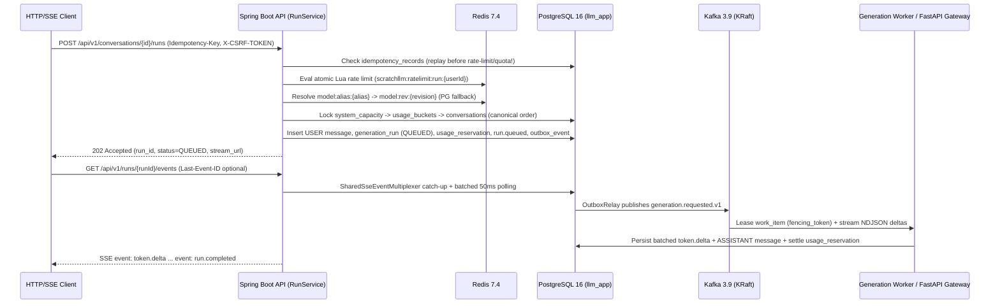
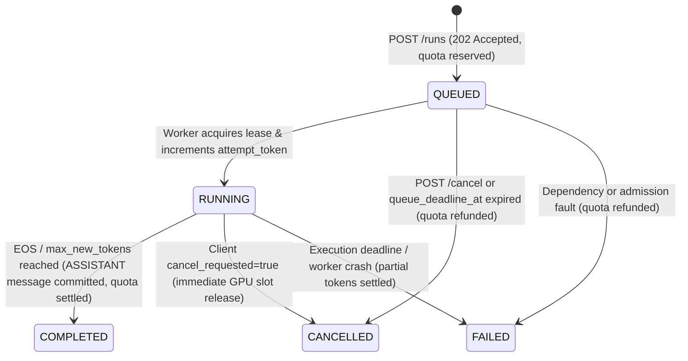

# Architecture Overview & Sequence/State Diagrams (`Day112`)

This document provides the implementation-verified architecture diagrams for the **ScratchLLM Platform (`v1.0.0`)**, matching the Java 21 / Spring Boot (`backend/`) and Python 3.12 / PyTorch (`ml/`) source code.

---

## 1. Synchronous Chat, Durable SSE & Transactional Outbox Sequence



---

## 2. Generation Run Lifecycle State Machine



---

## 3. Single-GPU Mutual Exclusion & Airflow-to-Native-Worker Bridge (`gpu_leases`)

```mermaid
flowchart LR
    Airflow["Airflow DAG\n(scratchlm_offline_training_dag.py)"] -->|POST /internal/training-jobs\nX-Internal-Service-Token| Bridge["InternalTrainingJobController\n(Spring Boot)"]
    Bridge -->|Lock singleton gpu_leases (id=1)\nVerify (native_pid, process_create_time_utc)| PG[("PostgreSQL\ntraining_jobs + gpu_leases")]
    NativeWorker["Native Host Training Worker\n(native_worker.py)"] -->|Poll & Execute CLI Steps\nHeartbeat + Lease Renewal| PG
    NativeWorker -->|Log Metrics & Register Candidate| MLflow[("MLflow Registry\n(:5001)")]
    OnlineRun["Online Run Request\n(model_alias=scratch-tiny)"] -->|Check gpu_leases (id=1)| PG
    PG -->|If holder_kind=TRAINING| Reject["503 GPU_BUSY_WITH_TRAINING\n(fake-deterministic still 202 OK)"]
```
