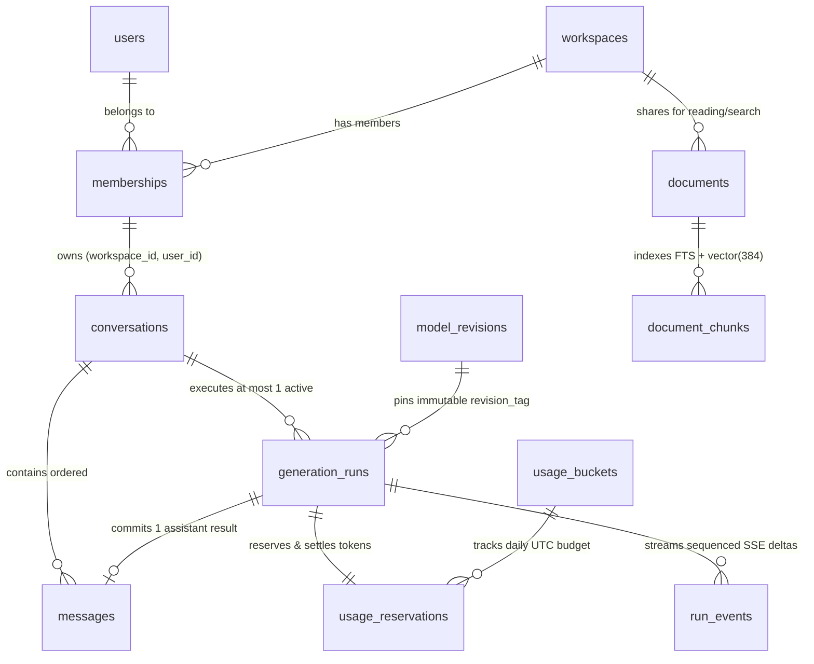

# Relational and Vector Schema Architecture

Status: Verified Foundation Schema (Day006 — Gate G1)
Migration Source: [`V1__phase1_foundation_schema.sql`](../backend/src/main/resources/db/migration/V1__phase1_foundation_schema.sql)

## 1. Entity-Relationship Diagram



## 2. Authorization Predicates (Creator-Private vs. Workspace-Shared)

1. **Conversations, Messages, Generation Runs, and Feedback (Creator-Private):**
   - Access requires **both** active membership in `memberships (workspace_id, user_id)` **and** `owner_user_id = :callerUserId`.
   - Enforced structurally by `fk_conversation_membership FOREIGN KEY (workspace_id, owner_user_id) REFERENCES memberships (workspace_id, user_id)` and mandatory service-level query predicates.
2. **Documents and Document Chunks (Workspace-Shared Read, Restricted Delete):**
   - Any member of `workspace_id` can read and search `READY` documents (`deleted_at IS NULL`).
   - Only `uploader_user_id` or a workspace `OWNER` may delete a document.

## 3. Concurrency Invariants and Partial Unique Indexes

1. **Single Active Run Per Conversation (`uq_active_run_per_conversation`):**
   ```sql
   CREATE UNIQUE INDEX uq_active_run_per_conversation
       ON generation_runs (conversation_id)
       WHERE status IN ('QUEUED', 'RUNNING');
   ```
   Prevents concurrent requests from interleaving two active generations in the same conversation, while allowing unlimited historical `COMPLETED`, `CANCELLED`, or `FAILED` runs.
2. **Single Assistant Output Per Run (`uq_assistant_msg_per_run`):**
   ```sql
   CREATE UNIQUE INDEX uq_assistant_msg_per_run
       ON messages (run_id)
       WHERE role = 'ASSISTANT';
   ```
   Guarantees that at-least-once worker execution can commit at most one assistant message per run.
3. **Deadlock-Free Lock Hierarchy:**
   Transactions that acquire multiple row locks always lock in the order:
   `system_capacity (id=1)` $\rightarrow$ `usage_buckets (workspace_id, user_id, utc_date)` $\rightarrow$ `conversations (id)` $\rightarrow$ `generation_runs (id)`.
