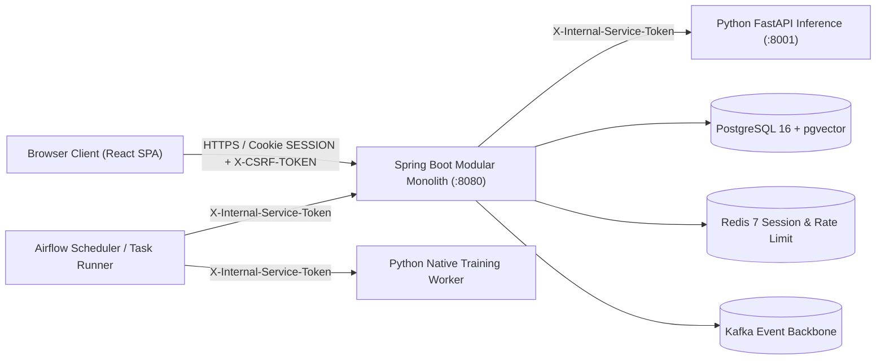

# Security Hardening & Threat Model Review (Day087)

## 1. System Trust Boundaries

1. **Public / Browser Boundary (`/auth/**`, `/api/v1/**`)**: Untrusted user input over HTTP/SSE.
2. **Internal Control-Plane Boundary (`/internal/training-jobs/**`, `/internal/v1/generate/**`)**: Machine-to-machine communication between Spring Boot, Python Inference Service, Airflow, and Native Training Worker.
3. **Artifact & Checkpoint Storage Boundary (`artifacts/`, MLflow)**: Model checkpoints, tokenizer artifacts, and user-uploaded documents.

---

## 2. Threat Model & Mitigations Matrix

| Threat ID | Component | Threat / Attack Vector | Implemented Control & Verification |
| :--- | :--- | :--- | :--- |
| **TM-01** | Browser Session & Auth | Session hijacking via XSS or credential leakage in URLs/logs | `SESSION` cookie uses `HttpOnly=true`, `SameSite=Lax` (`Secure=true` in production profile). `SecurityFoundationConfig` rejects any request passing `token=`, `access_token=`, `session_token=`, `internal_token=`, or `api_key=` in URL query parameters (`400 TOKEN_IN_URL_FORBIDDEN`). |
| **TM-02** | State-Changing APIs | Cross-Site Request Forgery (CSRF) on `/api/v1/**` | `CookieCsrfTokenRepository` enforces `X-CSRF-TOKEN` header matching CSRF cookie on all `POST`/`PUT`/`DELETE` browser endpoints (`403 CSRF_INVALID`). |
| **TM-03** | Internal Worker & Inference Bridges | Unauthorized task submission or GPU preemption | `/internal/training-jobs/**` and `/internal/v1/generate/**` require constant-time verified `X-Internal-Service-Token` (`401 INTERNAL_AUTH_FAILED`). |
| **TM-04** | Native Training Worker Bridge | Arbitrary command execution or shell injection via Airflow parameters | `TrainingJobAndGpuSupervisorService` and `native_worker.py` enforce `ALLOWLISTED_CONFIG_IDS` (`scratch-tiny-pretrain-v1`, `scratch-tiny-sft-v1`, `scratch-tiny-eval-v1`), regex identifier validation, and `subprocess.run(..., shell=False)` (`400 UNSAFE_INPUT_REJECTED`). |
| **TM-05** | Document Ingestion (`POST /api/v1/documents`) | Path traversal (`../`), oversized payloads, or null-byte injection | `DocumentIngestionAndRetrievalService` rejects filenames containing `..`, `/`, `\`, or control chars (`400 UNSAFE_FILENAME`), rejects null bytes, and caps UTF-8 size at 256 KiB. |
| **TM-06** | PyTorch Checkpoint Loading | Malicious pickle deserialization RCE when loading checkpoints | All checkpoint loads in `trainer.py`, `exporter.py`, and `cli_steps.py` verify the SHA-256 digest before loading and invoke `torch.load(..., weights_only=True)`. |
| **TM-07** | Multi-Tenant Data & Retrieval Isolation | Cross-workspace conversation or RAG chunk leakage | Every SQL query in `ConversationService`, `RunService`, and `DocumentIngestionAndRetrievalService` filters by authenticated `(workspace_id, owner_user_id)` before returning rows or assembling RAG prompts. |
| **TM-08** | Observability & Logs | Leakage of user prompts, documents, or tokens into logs/metrics | `RequestIdFilter` and `ObservabilityAndMetricsController` log only `request_id`, `correlation_id`, status codes, and bounded counters—never raw prompts, document chunks, or secrets. |
